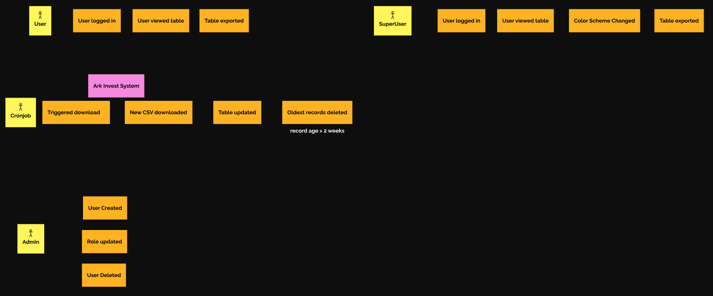
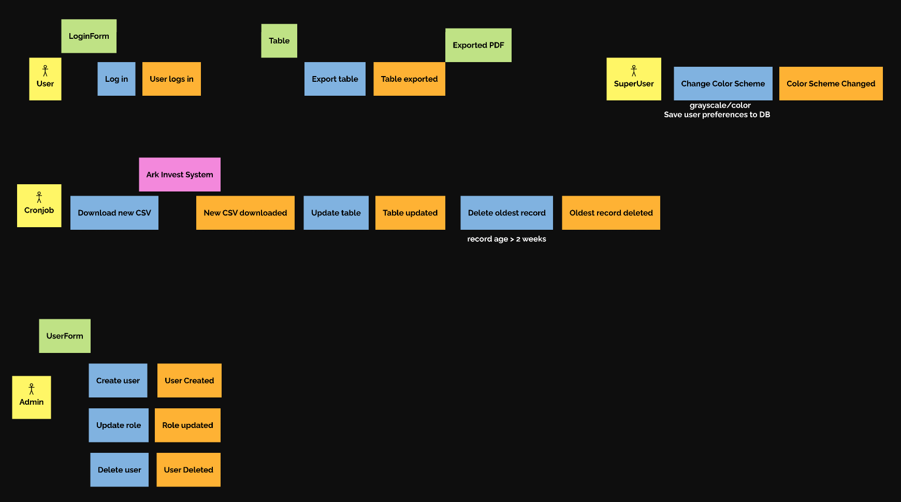
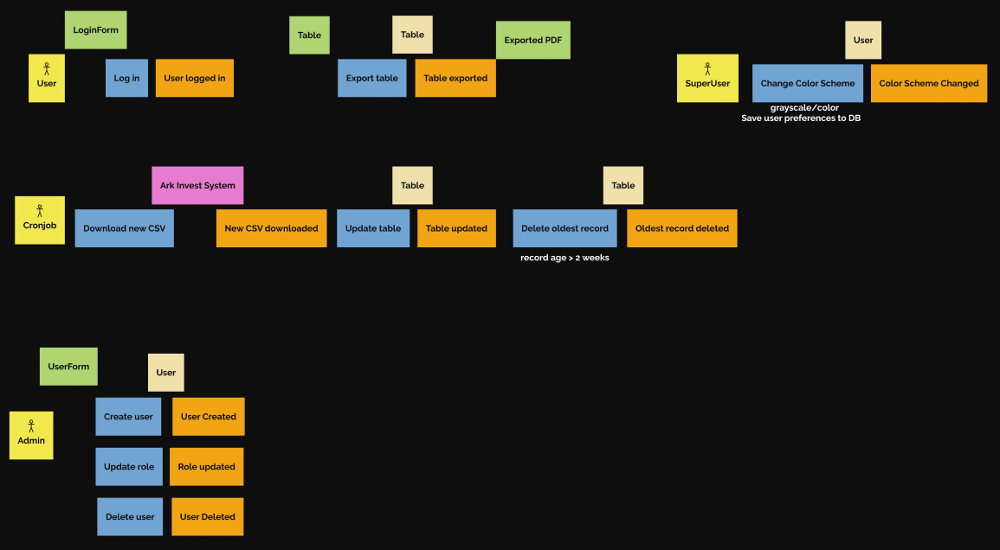

# PV260_notino_team3

## Figma
https://www.figma.com/design/4LdSh4w5wm4Hoy7umbKOcJ/Event-Storming--Community-?node-id=48-12914&p=f&t=HERhYRbRrVvt1Prk-0

### Big picture

### Process Modeling

### Software design

## User stories

### User story

As a User, I want To Login so that I can View the stocks diff Table..

**Estimation:** 5 Story Points

Acceptance criteria:

- table shown after login

Out of scope:

- password reset  
- user creation

### User story

As a SuperUser, I want to Toggle the color scheme so that the Table is prettier :).

**Estimation:** 2 Story Points

Acceptance criteria:

- table color changed

Out of scope:

- custom color choice

### User story

As a User, I want to export the table as PDF so that I have it downloaded.

**Estimation:** 5 Story Points

Acceptance criteria:

- PDF downloaded  
- PDF table is the same as the table on the page

Out of scope:

- exporting historical table data

### User story

As a User, I want to view up to date data so that I can make the right decisions.

**Estimation:** 3 Story Points

Acceptance criteria:

- the data is updated every hour

### User story

As Admin, I want to create new Users so that they can login and use the App.

**Estimation:** 5 Story Points

Acceptance criteria:

- a new user is created  
- admin can set a specific role to the new user  
- the new user can log in

### User story

As an Admin, I want to Delete a User so that they cannot login and view the table.

**Estimation:** 2 Story Points

Acceptance criteria:

- User is deleted  
- User cannot login

Out of scope:

- User account restoration

### User story

As an Admin, I want to Update the role of a user so that They can have more permissions.

**Estimation:** 2 Story Points

Acceptance criteria:

- user role is updated

Out of scope:

- Admin changing the role of another user

### User story
As an Admin, I want to see a distinct color scheme so that my interface is different to a regular User or SuperUser.

Acceptance criteria:

- Admin interface uses a different color scheme

Out of scope:
- Adding more color schemes

### User story
As a System Administrator, I want old records to be automatically deleted so that the database remains clean.

Acceptance criteria:

- More than two week old records are deleted automatically

Out of scope:

- Manual deleting of records by users or admins

### User story
As an Admin, I want to change a user's password so that I can manage their access credentials.

Acceptance criteria:

- Admin can update the password for an existing user

Out of scope:

- Admin changing the user's login name
- Admin changing the password of other admins

### User story
As a Super Admin, I want to be the only one who can manage other Admins so that I have total control over who manages the system.

Acceptance criteria:
- Super admin can do anything a regular admin can
- Super Admin can alse create, modify, and delete other Admins
- Regular Admins cannot manage other Admins

Out of scope:

- Multiple Super Admin accounts

## Authors:
- 567816 Maros Pavlik
- 536407 Lubomir Jurcisin
- 536533 Martin Mackovic
- 536638 Marcel Nadzam
- 536589 Dominik Augustin
